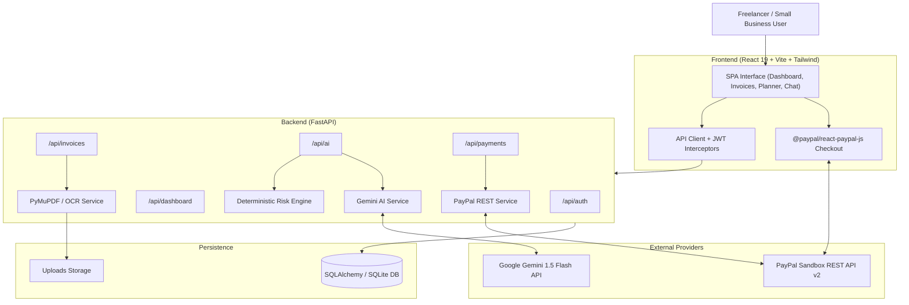

# PayFlow AI — System Architecture

## Architecture Diagram

## Security & Verification Flow

1. **Idempotency & Duplicate Guards**:
   - Invoices marked `paid` cannot be charged again.
   - Pending transactions are tracked with uniqueness constraints on order IDs.
2. **Server-Side Capture Verification**:
   - Client-side callbacks do not determine payment truth.
   - The backend directly executes `POST /v2/checkout/orders/{id}/capture` with PayPal's OAuth2 bearer token and validates amount match, currency code, and capture status.
3. **Graceful Fallback**:
   - Both AI and PayPal modules gracefully handle unconfigured credentials with transparent simulation badges, ensuring seamless judging evaluation.
